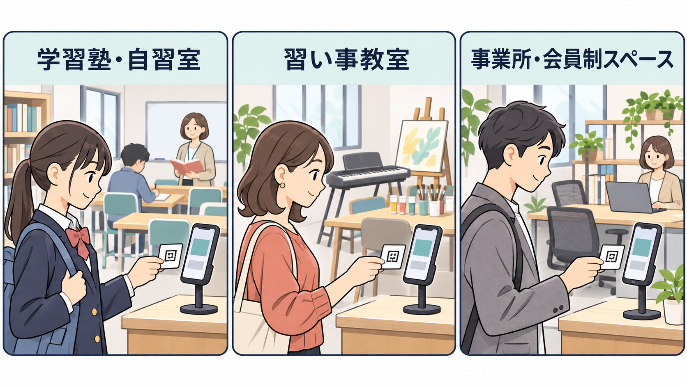
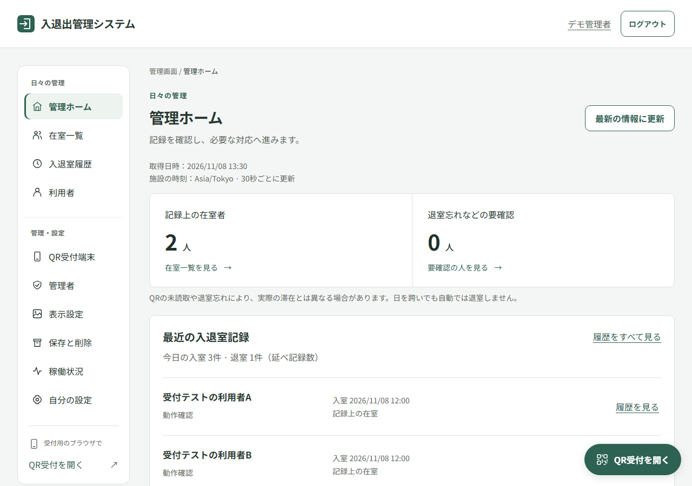
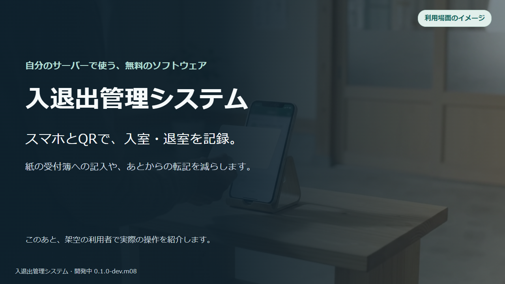
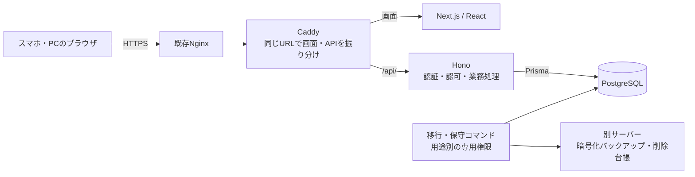

# 入退出管理システム

入口のスマートフォンで一人ずつのQRコードを読み取り、入室・退室の時刻を記録するソフトウェアです。管理者は「記録上、誰が在室しているか」を確認できます。学習塾・自習室・習い事の教室・小規模な事業所などで、紙の受付簿への記入や転記を減らす用途を想定しています。

自分で用意したサーバーに設置して使う、無料のオープンソースソフトウェアです。日々の受付・管理はブラウザで操作します。サーバーへの設置と保守には、サーバーを管理できる方が必要です。

現在は開発中です。動作確認には架空データを使用してください。導入用イメージの一般配布は準備中です。ソースコードから試す場合は[開発者向けガイド](docs/development.md)を参照してください。

## 利用を想定している場面

利用場面を説明するイラストです。入口の受付スマホで個人QRを読み取り、来室・退室を記録する使い方を想定しています。

| 施設・場面 | 使い方の例 |
| --- | --- |
| 学習塾・自習室 | 生徒が来たときと帰るときに、入口の受付スマホで個人QRを読み取ります。講師や受付担当者は、記録上の在室者と来退室の時刻を確認できます。 |
| 習い事の教室 | 受講者の来室・退室を記録し、あとから履歴を確認します。利用者のアカウントは不要で、紙のQRカードでも受付できます。 |
| 小規模な事業所・会員制スペース | 登録したスタッフや会員の出入りを記録し、記録上の在室者や過去の入退出時刻を確認します。 |

1組織・1施設での利用を想定しています。保護者への通知、授業予約、月謝管理、勤務時間・給与の計算は含みません。[機能と利用上の制限](docs/overview.md)も確認してください。

## できること

| 行いたいこと | できること |
| --- | --- |
| 利用者へQRを配る | 名前などを登録して個人QRを発行・印刷できます。再発行すると、古いQRは使えなくなります。 |
| 入口で受付する | 承認した受付スマホで、紙やスマホ画面のQRを読み取ります。入退出する人のアカウントは不要です。 |
| 在室者や過去の記録を調べる | 管理ホーム・在室一覧・履歴で確認できます。理由を残した訂正・取消・手動追加、CSVでの保存もできます。 |
| 管理者や端末を管理する | 管理者はパスキーでログインします。管理者の招待・停止、受付端末の承認・失効ができます。 |
| 施設に合わせて設定する | 表示名・アイコン・ブラウザのタブのアイコン、記録の保存期間を設定できます。個人情報の削除状況も確認できます。 |

1設置につき1組織・1施設です。扉の解錠、通信がない状態での確定記録、決済、通知、多組織SaaSは対象外です。QRの貸し借りや退室忘れがあると、記録と実際の滞在は異なる場合があります。

## 画面例

架空データを使った表示確認用の画面例です。実際の施設や利用者の記録ではありません。[スマホの管理者一覧](docs/images/administrators-mobile.png)も確認できます。

[操作デモを見る（約1分56秒・日本語ナレーション・BGM付き）](docs/videos/overview.mp4)。学習塾などでの利用想定を紹介し、架空の利用者で入室・退室を記録する流れを示します。操作画面は自動操作用ブラウザとテスト用カメラで収録しています。冒頭には、入口と管理者の利用場面を表すイメージ映像を入れています。[動画の内容を文字で読む](docs/videos/README.md)こともできます。

## 受付の流れ

1. **管理者が準備する**：利用者を登録してQRを配り、入口で使う受付端末を承認します。
2. **入室を記録する**：受付端末で「入室」を選び、QRを読み取ります。完了の表示を確認します。
3. **在室者を確認する**：管理者の端末で在室一覧を開きます。
4. **退室を記録する**：受付端末を「退室」に切り替えて同じQRを読み取ります。入退室履歴に両方の時刻が残ります。

管理者の端末は名簿や記録を管理するためのもの、受付端末は入口でQRを読むためのものです。管理者のログインと受付端末の承認は別の手続きです。初めて試す場合は、[架空の1人でテスト受付する手順](docs/usage.md#はじめてのテスト受付)に沿って進めてください。

## どこまで確認しているか

2026年11月8日時点の開発版 `0.1.0-dev.m08` について、確認した範囲を分けて記載しています。

| 確認方法 | 確認できている範囲 |
| --- | --- |
| 自動テスト | 登録・認証・受付・在室・履歴・訂正などの操作に加え、権限違反、二重送信、同時操作、通信失敗などを確認しています。 |
| スマホ実機 | iPhoneのSafariとAndroidのChromeで、以前の工程でパスキーとQR入退室を確認しています。M08では版表示・指定した表示変更・右下からQR受付へ移動する操作を確認しました。 |
| 導入・運用 | 分離したテスト環境での起動・更新・復元と、検証サーバーへの画面更新を確認しています。空の標準サーバーへの導入と、独立した外部保管先を使う運用には未確認項目があります。 |

自動テストだけで、実機のカメラや読み上げを確認したことにも、すべての端末での動作を保証することにもなりません。[検査項目数・条件・残っている確認](docs/overview.md#確認できている範囲)も参照してください。正式リリースと本番運用の受入は継続中です。

## 使い始める

| 行いたいこと | 入口 |
| --- | --- |
| サーバーへ設置する | [導入に必要なものと手順](docs/install.md) |
| 初回設定からテスト受付まで試す | [はじめてのテスト受付](docs/usage.md#はじめてのテスト受付) |
| 機能と確認済みの範囲を詳しく知る | [できることと確認できている範囲](docs/overview.md) |
| 管理者・受付端末・日々の操作を確認する | [画面の使い方](docs/usage.md) |
| 更新、保存期間、バックアップ、復元を管理する | [更新・バックアップ・復元](docs/operations.md) |
| 操作や起動で困っている | [困ったときの対処](docs/troubleshooting.md) |

iPhoneはSafari、AndroidはChromeアプリから、設置したHTTPSのURLを直接開いてください。LINEなどのアプリ内ブラウザでは、パスキーやカメラを利用できない場合があります。

## 想定サーバー

**Ubuntu 24.04 LTS（x86_64 / amd64）にDocker EngineとDocker Composeを入れたLinuxサーバー**を基準にしています。画面・API・専用PostgreSQLを同じサーバーのコンテナで起動する構成です。ホストへNode.jsをインストールしたり、Next.jsをビルドしたりする必要はありません。

| 設置先 | 現在の扱い |
| --- | --- |
| UbuntuのVPS | 既存VPSへの配置・更新、HTTPS接続、段階ごとのスマホ操作を確認しています |
| Ubuntuの物理サーバー | 同じOS・CPU構成の設置候補です。実機での導入確認は未実施です |
| AWS EC2 / GCP Compute Engine | Ubuntuの仮想サーバーを用意する設置候補です。各クラウド上での動作確認は未実施です |
| AWS ECS＋Fargate / GCP Cloud Run | 現在のCompose構成やホストの保守手順をそのまま使う対象ではありません。DB・秘密情報・定期処理などの構成調整と検証が必要です |

ホストにはsudo/rootでの管理、Python 3・GnuPG・OpenSSH、DB用の永続ディスク、スマホから接続できるHTTPSのURLが必要です。現在の[導入手順](docs/install.md)は、既存Nginxから専用コンテナへ接続する方法を案内しています。バックアップと削除台帳は別サーバーへ保管し、復号鍵も分けて管理します。

既存VPSでの確認は、空のUbuntuへ公開手順だけで導入する確認とは別です。容量・メモリの診断条件と、残っている確認は[導入手順](docs/install.md)と[確認済みの範囲](docs/overview.md#確認できている範囲)を参照してください。

## 使用技術

| 担当 | 使用技術 |
| --- | --- |
| 画面 | Next.js 16.4.5 / React 19.3.1 / App Router |
| API | Hono 4.13.16 / Node.js 24.22.2 |
| 型・入力検証 | TypeScript 6.0.3 / Zod 4.6.7 |
| 管理者認証 | Better Auth 1.7.18 / パスキー（WebAuthn） |
| データベース | PostgreSQL 18.6 / Prisma 7.10.1 |
| コンテナ・振り分け | Docker Compose / Caddy 2.11.9 |
| 自動検査 | Vitest 5.1.0 / Playwright 1.65.0 / ESLint 10.14.0 |

依存関係はロックファイルと固定したイメージのタグで管理します。各ソフトウェアの利用条件は[ライセンス案内](docs/licenses.md)を確認してください。

## システム構成

図は現在の導入手順の構成です。画面とAPIは同じHTTPS URLから利用し、DBへ接続する処理はHonoに集約しています。Next.jsへDB資格情報を渡さず、DBポートも外部へ公開しません。移行や保守では通常APIと別の権限を使います。

## 開発・改修する方へ

- [開発者向けガイド](docs/development.md)：ディレクトリ構造、各フォルダーの役割、開発・テスト手順
- [DB設計ガイド](docs/database.md)：ER図、各テーブルの役割、制約と同時操作への対応

## 導入・運用上の制限

固定イメージの導入・更新、暗号化バックアップ、削除台帳を適用した復元の仕組みは実装しています。初回導入、実際の外部保管先を使う運用、端末・ブラウザでの確認状況は[確認済みの範囲](docs/overview.md#確認できている範囲)にまとめています。

バックアップと最新の削除台帳には、アプリサーバーとは別のサーバーが必要です。外部保管を確認できないまま削除を完了扱いにしない設計で、画面上の削除指示は処理待ち・保留になる場合があります。復号用の秘密鍵は保管先とも分けて管理します。

ソフトウェアは[MITライセンス](LICENSE)です。著作権表示とライセンス本文を残す条件で、利用・改修・再配布・商用利用ができます。無保証での提供です。サーバー、ドメイン、外部バックアップなどの運用費は設置者が負担します。[第三者ソフトウェアのライセンス](docs/licenses.md)も確認してください。

## 不具合・脆弱性の報告

通常の不具合や改善案は[GitHub Issues](https://github.com/mameoffice/mame-inout/issues)へ報告してください。画面下部の版、端末・OS・ブラウザ、再現手順、期待した結果と実際の結果を添えると確認しやすくなります。氏名・QR・復旧コード・Cookie・秘密鍵・DB資格情報は載せないでください。

脆弱性や漏洩の可能性を含む報告は、公開Issueに詳細を書かず、[セキュリティに関する案内](SECURITY.md)に従ってください。
