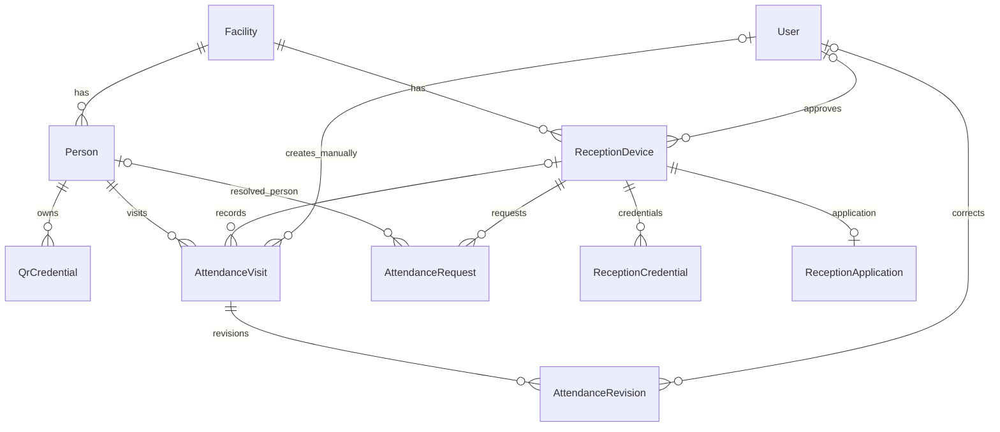
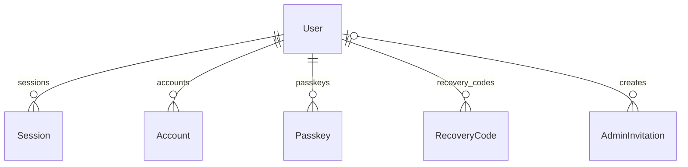

# データベース構造

入退出管理システムはPostgreSQLを使用します。名簿・入退室・受付端末の情報と、管理者の認証情報を同じDBに保存し、Hono側で認証・認可・トランザクションを扱います。Next.jsはDBへ直接接続しません。

このガイドは、現在のスキーマと移行SQLに対応する構造の説明です。スキーマにはPrismaモデルが26個あり、移行処理が別途作成する `SchemaMigration` を含めると27表です。フィールドの完全な一覧は[Prismaスキーマ](../apps/api/prisma/schema.prisma)、実際の制約・権限は[移行SQL](../apps/api/prisma/migrations)を確認してください。

## 業務データの関係

初期版は1組織・1施設です。`Facility.id = 1` の設定行を使い、利用者と受付端末はその施設に属します。入退出する人の `Person` と、ログインする管理者の `User` は別の情報です。

図の線はDBに定義した外部キーの関係です。監査イベントから各対象への任意参照は、図を読みやすくするため省略しています。

| テーブル | 主キー・主要な列 | 役割 |
| --- | --- | --- |
| `Facility` | `id`、`name`、`timeZone` | 施設名と表示用タイムゾーン。1行に限定します。 |
| `Person` | `id`、`facilityId`、`displayName`、`code`、`status`、`version` | 入退出する人の名簿。状態は有効・停止・個人情報削除済みを区別します。 |
| `QrCredential` | `id`、`personId`、`tokenHash`、`issuedAt`、`revokedAt` | 個人QRの照合用ハッシュと発行・失効履歴。QR生値は保存しません。 |
| `ReceptionDevice` | `id`、`facilityId`、`status`、`approvedById`、`expiresAt` | QR受付に使うブラウザの承認状態・期限。管理者のログインとは別に管理します。 |
| `ReceptionCredential` | `id`、`deviceId`、`tokenHash`、`expiresAt`、`revokedAt` | 承認済み受付端末に渡す資格の照合用ハッシュ。 |
| `ReceptionApplication` | `tokenHash`、`deviceId`、`confirmationCode`、`expiresAt`、`claimedAt` | 端末の申請と利用開始の状態。申請元の秘密資格のハッシュと、管理者が画面で照合する確認コードを分けます。 |
| `AttendanceVisit` | `id`、`personId`、`enteredAt`、`exitedAt`、`canceledAt`、`version`、`source` | 1回の入室から退室までの記録。受付端末または管理者による作成元も保持します。 |
| `AttendanceRequest` | `id`、`deviceId`、`acceptUntil`、`resultUntil`、`payloadHash`、`httpStatus`、`response` | 受付の要求IDと確定応答。通信失敗後の再送・結果照会で二重記録を防ぎます。 |
| `AttendanceRevision` | `id`、`visitId`、`actorUserId`、`reason`、`before`、`after` | 管理者による手動追加・訂正・取消の変更前後と理由。 |
| `AuditEvent` | `id`、`action`、`actorType`、各対象ID、`details`、`createdAt` | 管理・受付・保守操作の監査。管理者・端末・利用者・入退室・受付要求を任意に参照します。 |

`AttendanceVisit.personId` は削除を制限する外部キーです。個人情報削除では名簿行を単純に物理削除せず、表示名等の消去と履歴の保持を分けます。管理者や端末が削除されても履歴の行を連鎖削除しない参照には `ON DELETE SET NULL` を使用しています。

## 管理者認証と初期設定

| テーブル | 主キー・主要な列 | 役割 |
| --- | --- | --- |
| `User` | `id`、`name`、`email`、`role`、`status`、`authVersion` | 管理者。停止状態と認証世代を持ち、資格の失効・復旧を管理します。 |
| `Session` | `id`、`userId`、`token`、`expiresAt`、`lastActivityAt`、`authenticatedAt`、`passkeyId` | Better Authのログインセッション。無操作期限と重要操作の再認証時刻を区別します。 |
| `Account` | `id`、`userId`、`providerId`、`accountId` | Better Authのアカウント用モデル。列が存在することは、各外部ログインやパスワードログインを提供していることを意味しません。 |
| `Verification` | `id`、`identifier`、`value`、`expiresAt` | 認証ライブラリが扱う短命の検証状態。パスキーのチャレンジ等に使います。 |
| `Passkey` | `id`、`userId`、`credentialID`、`publicKey`、`counter`、`lastUsedAt` | パスキーの公開鍵・資格情報ID・利用状態。利用者端末の秘密鍵は保存しません。 |
| `SetupState` | `id`、`codeHash`、`expiresAt`、`completedAt` | 最初の管理者登録の共通状態。1行をロックし、登録完了後は設定コードのハッシュと期限を消します。 |
| `SetupAttempt` | `tokenHash`、`userId`、`codeHash`、`name`、`email`、`expiresAt` | 初期パスキー登録前の短命な申請。パスキー検証前に管理者を確定しません。 |
| `RateBucket` | `key`、`count`、`startedAt` | 複数APIプロセスで共有する試行制限の計数。 |
| `AdminInvitation` | `id`、`codeHash`、`name`、`email`、`expiresAt`、`usedAt`、`createdById` | 管理者の招待先・期限・消費状態。招待コードは照合用ハッシュを保存します。 |
| `RegistrationAttempt` | `tokenHash`、`kind`、`userId`、`version`、`invitationId`、`sessionId`、`expiresAt` | パスキー追加・招待受諾・復旧に限定した短命の登録許可。 |
| `RecoveryCode` | `codeHash`、`userId`、`usedAt` | 一度だけ使える復旧コードの照合用ハッシュと消費状態。 |

`SetupAttempt.userId` は登録予定のIDで、まだ存在しない `User` を参照するための外部キーではありません。`RegistrationAttempt` のユーザー・招待・セッションIDや、`Session.passkeyId` も外部キーではなく、実装側で用途・期限・対象・認証世代を照合する参照値です。ER図にこれらの値を外部キーとして描いていません。

QR・受付資格・設定コード・招待コード・復旧コードの独自処理にはSHA-256の照合用ハッシュを使用します。一方、`Session.token` や `Verification.value` 等は認証ライブラリの管理形式です。すべての認証値が同じ形式のハッシュで保存されるとは扱わないでください。DB全体・ダンプ・バックアップは機密情報として保護します。

認証処理の実装は [auth.ts](../apps/api/src/auth.ts)、初期登録は [setup.ts](../apps/api/src/setup.ts)、招待・追加・復旧は [identity.ts](../apps/api/src/identity.ts) にあります。

## 表示・保存期間・削除・移行

| テーブル | 主キー・主要な列 | 役割 |
| --- | --- | --- |
| `Appearance` | `id`、`displayName`、`icon`、`favicon`、`version` | 単一設置の表示名と画像。施設IDや認証のOriginとは独立しています。 |
| `PrivacyState` | `id`、`deploymentId`、`generation`、`lastBackupAt`、`backupExternalConfirmed` | 設置単位の削除台帳の世代とバックアップ状態。 |
| `RetentionPolicy` | `id`、`days`、`version`、`backupRetentionDays`、前回処理の日時・件数 | 記録とバックアップの保持設定。設定値と実際の保守処理の実行は区別します。 |
| `DeletionInstruction` | `operationId`、`sequence`、`personId`、`requestedAt` | 個人情報の削除指示。世代順序と利用者ごとの重複を制限し、通常APIでは追記のみを許します。 |
| `DeletionProgress` | `operationId`、`completedAt`、`lastAttemptAt`、`errorCode` | 削除指示に対する処理の完了・失敗。指示そのものとは別に更新します。 |
| `SchemaMigration` | `name`、`checksum`、`appliedAt` | 適用済みSQLの名前・SHA-256・適用時刻。Prismaスキーマのモデルには含めず、移行処理が作成します。 |

`DeletionInstruction.personId` は外部キーにしていません。過去のDBを復元した後にも削除を再適用するため、削除対象の名簿行と指示の寿命を結び付けない設計です。`DeletionProgress.operationId` は指示への外部キーで、指示の削除を制限します。

`Appearance`、`PrivacyState`、`RetentionPolicy` は `id = 1` に限定します。表示画像はDBの `bytea` に保存し、SQLでは各64KiB以下に制限しています。画像形式・寸法等の検査は [appearance-png.ts](../apps/api/src/appearance-png.ts) でも行います。

## 整合性を守る仕組み

### DBで強制する制約

| 守る条件 | 定義 |
| --- | --- |
| 有効なQRは利用者ごとに最大1件 | `QrCredential_one_active_per_person`。`revokedAt IS NULL` の行だけを対象にした部分一意インデックス。 |
| 有効な未退室記録は利用者ごとに最大1件 | `AttendanceVisit_one_open_per_person`。`exitedAt IS NULL AND canceledAt IS NULL` の行を対象にした部分一意インデックス。 |
| 同じ施設内の利用者コードを重複させない | `Person(facilityId, code)` の一意制約。コード未設定の `NULL` は複数行で使用できます。 |
| メール・パスキー資格情報ID・各種資格ハッシュを重複させない | 各対象列の一意制約または主キー。 |
| 入退室の時刻順序 | `AttendanceVisit_times_check` により、退室日時は入室日時以降。未来時刻の拒否はAPI側で行います。 |
| 受付要求の期限と確定応答の列を整合させる | `issuedAt < acceptUntil <= resultUntil`。未確定時は応答列がすべて未設定、確定時は本文ハッシュ・200または409・応答JSON・完了時刻をそろえます。 |
| 不正な状態・空の名称や理由・不正な版を拒否する | `CHECK` による状態値、文字数、正の `version`、JSON形式等の検査。 |
| 存在しない対象を業務記録から参照しない | 外部キーと `RESTRICT`・`SET NULL`・`CASCADE` の削除規則。用途により使い分けます。 |

部分一意インデックスや `CHECK`、権限設定は、Prismaモデルの記述だけでは完全には表せません。[受付の移行SQL](../apps/api/prisma/migrations/202611070002_attendance/migration.sql)と後続のSQLを合わせて確認してください。

### 同時操作・区間の重複

[attendance.ts](../apps/api/src/attendance.ts) は、通常受付・手動追加・訂正・取消で対象利用者の `Person` 行を `SELECT ... FOR UPDATE` でロックします。利用停止やQR再発行も [people.ts](../apps/api/src/people.ts) で同じ親行をロックするため、同じ利用者への変更を直列化します。

過去の在室区間の重複は、ロックを保持したトランザクションの中で `assertNoOverlap` が確認します。区間は `[入室, 退室)` として扱い、退室時刻と次の入室時刻が接する記録、入退室が同時刻の終了済み記録は重複にしません。現在の移行SQLには、この区間重複を単独で防ぐ `EXCLUDE` 制約やトリガーはありません。SQLの直接更新はこの検査を通らないため、業務データの変更はAPIの処理経路を使ってください。

受付の処理中は端末と資格に共有ロックを保持し、失効と競合した場合の状態・期限を再検査します。訂正や名簿変更では `expectedVersion` を照合し、古い画面からの上書きを拒否してから版を進めます。

### 二重送信と通信失敗

QR受付では、先にサーバーが `AttendanceRequest.id` を発行します。記録時はその行をロックし、入退室モードとQRから計算した `payloadHash`、結果、HTTP状態を同じトランザクションで保存します。

- 同じ要求ID・同じ内容の再送は、保存済みの最初の結果を返します。
- 同じ要求IDへ異なる内容を送った場合は競合として拒否します。
- 通信が切れた場合は、その要求IDの結果を照会できます。
- 未発行・期限切れ・保持終了後の要求IDから、新しい受付記録を自動作成しません。

受付の受理期限と結果照会期限は別です。手動追加では、要求IDを記録の主キーに対応させ、最初の追記専用の変更履歴と照合します。異なる利用者を対象とした同一IDの競合も、主キー制約と処理結果の再照合で拒否します。

### 訂正・取消と時刻

通常のQR受付時刻は、トランザクション中のPostgreSQLの `clock_timestamp()` で決定します。日時列は `timestamptz` により時点として保存し、APIではUTCのISO形式、画面・CSVでは施設の `timeZone` を使って表示します。日付が変わっても自動退室しません。

手動追加・訂正は入力検証と現在時刻の検査を行い、変更前後・理由・実行管理者を `AttendanceRevision`、操作を `AuditEvent` に同時保存します。取消は `canceledAt` を設定し、有効な在室・通常集計から除外します。履歴行そのものを通常APIで削除する処理ではありません。

## DB権限と保守

[ロールの初期化](../infra/postgres/init.sh)で、通常API・移行・バックアップ・保持削除の資格を分けます。

| ロール | 用途と制限 |
| --- | --- |
| `mame_app` | 通常API。DB管理者・スキーマ所有者にせず、DDLを許しません。監査・変更履歴は参照と追記に限定し、既存行の更新・削除を拒否します。 |
| `mame_migrate` | 移行専用。スキーマと移行台帳を管理します。通常APIには渡しません。 |
| `mame_backup` | バックアップ専用の読み取り権限。 |
| `mame_maintenance` | 個人情報削除・保持期限処理・復元時の再適用。対象表と操作を限定し、DDLや移行台帳の変更は許しません。 |

削除指示と進捗への通常APIの権限も分けています。指示の追加や保持期間の設定変更はできますが、指示の消去や削除完了の偽装はできません。専用保守処理では、外部保管した最新の削除台帳を確認した上で名簿情報や複製された表示名等を消去します。保持期限処理は、未退室の記録を日数だけで削除しません。

削除台帳の世代確定・再適用・保持処理は、アドバイザリーロックと設定行のロックを使って競合を避けます。詳細は [privacy-maintenance-core.ts](../apps/api/src/privacy-maintenance-core.ts)、導入者向けの操作は[更新・バックアップ・復元](operations.md)を参照してください。

## スキーマを変更するとき

[migrate.ts](../apps/api/src/migrate.ts) は、移行用接続でアドバイザリーロックを取り、名前順にSQLを適用します。移行SQLと `SchemaMigration` の記録を同じトランザクションで確定し、適用済みSQLのSHA-256が変わった場合は停止します。

適用済みの移行ファイルを編集せず、新しい移行を追加してください。Prismaモデル・移行SQL・業務処理・入力スキーマをそろえ、DBの部分一意制約・権限も維持します。`prisma db push` で、このSQLによる制約や独自移行台帳を置き換えないでください。

変更後の確認箇所は、[受付とDB制約の結合テスト](../tests/integration/attendance.test.ts)、[履歴・訂正](../tests/integration/history.test.ts)、[名簿・QR](../tests/integration/people.test.ts)、[認証・権限](../tests/integration/identity.test.ts)、[保存・削除](../tests/integration/privacy.test.ts)です。実行方法は[開発者向けガイド](development.md)を参照してください。
