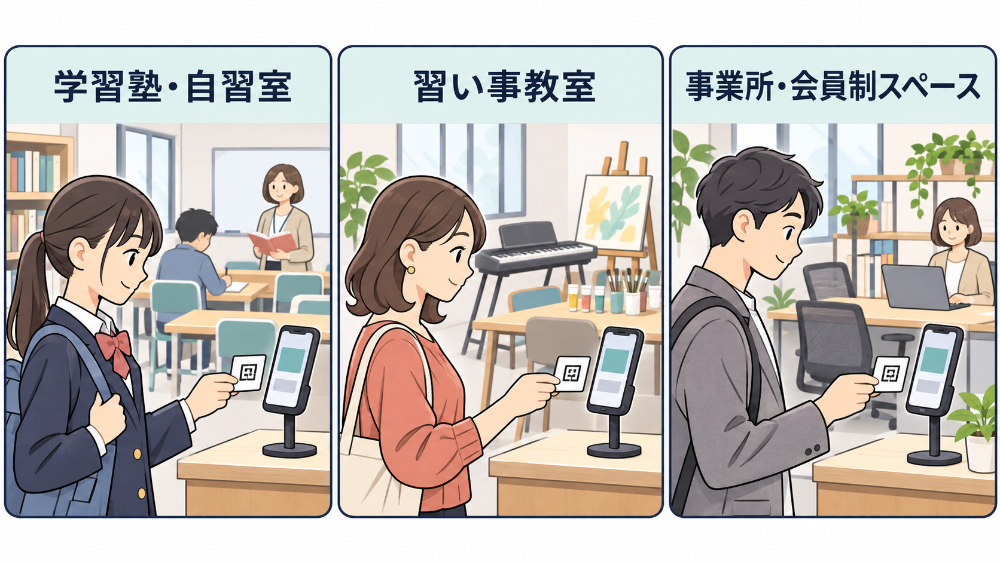

# できることと確認できている範囲

入退出管理システムは、入口のスマートフォンで個人QRを読み取り、入室・退室を記録するソフトウェアです。自分で用意したサーバーに設置して使います。初期版は1組織・1施設を対象とし、入退出する人にアカウントを作ってもらう必要はありません。

現在は開発中です。ここで説明する実装済みの機能と、正式リリース前に残っている確認は分けて読んでください。

[約1分56秒の操作デモを見る](videos/overview.mp4)と、利用者登録から入室・在室確認・退室・履歴確認までの流れが分かります。[動画の内容を文字で読む](videos/README.md)こともできます。

## 利用を想定している場面

紙の受付簿への記入や転記を減らすため、次のような使い方を想定しています。

| 施設・場面 | 使い方の例 |
| --- | --- |
| 学習塾・自習室 | 生徒が入口の受付スマホに個人QRをかざし、来室・退室を記録します。講師や受付担当者は、記録上の在室者を一覧で確認します。 |
| 習い事の教室 | 受講者の来室・退室を記録し、あとから履歴を確認します。利用者ごとのアカウントは不要で、紙のQRカードでも受付できます。 |
| 小規模な事業所・会員制スペース | あらかじめ登録したスタッフや会員の出入りを記録し、記録上の在室者や過去の入退出時刻を確認します。 |

1設置につき1組織・1施設で使います。保護者への通知、授業の予約や月謝の管理、勤務時間・給与の計算は含みません。

## 誰が何を操作するか

| 操作する人・端末 | 主な操作 |
| --- | --- |
| 管理者の端末 | パスキーでログインし、利用者の登録、QRの発行、受付端末の承認、在室・履歴の確認を行います。 |
| 入口の受付端末 | 管理者から承認されたブラウザでQRを読み取り、入室または退室を記録します。名簿全体や履歴は表示しません。 |
| 入退出する人 | 紙またはスマホ画面の個人QRを受付端末にかざします。ログインは不要です。 |
| サーバー管理者 | サーバーの設置・更新・バックアップ・復元を担当します。日々の受付とは別の作業です。 |

管理者のログインと受付端末の承認は別です。同じスマホを両方の用途で使う場合も、受付端末としての登録が必要です。共有の受付端末に管理者個人のパスキーを追加する運用は避けてください。

## 実装している機能

| 場面 | できること | 知っておくこと |
| --- | --- | --- |
| 利用前の準備 | 利用者の登録・検索・編集、QRの発行・印刷、受付端末の承認 | QRは閉じた後に再表示できません。再発行すると古いQRは使えなくなります。 |
| 入室・退室 | 紙・スマホ画面のQRを読み取り、サーバーが確定した時刻を記録 | 入室・退室は手動で選びます。通信がない状態で受付完了にはしません。 |
| 現在の確認 | 記録上の在室人数・在室者、退室忘れなどの要確認表示 | 日付が変わっても自動退室しません。記録と実際の滞在は異なる場合があります。 |
| 過去の確認・修正 | 履歴の検索、理由を残した訂正・取消・手動追加、CSV保存 | 同時更新や時刻の重なりなど、不整合になる操作は拒否します。 |
| 管理・設定 | 管理者の招待・停止、パスキーの追加・失効、復旧、受付端末の管理 | 確認が必要な操作では、対象と影響を示します。パスキーで再確認する場合があります。 |
| 表示・保存の設定 | 表示名・アイコン・タブのアイコン、保存期間、個人情報の削除状況 | 削除には外部保管などの条件があり、指示後すぐに完了しない場合があります。 |

実際の画面と手順は[画面の使い方](usage.md)を参照してください。[最初のテスト受付](usage.md#はじめてのテスト受付)は、架空の1人で「登録→QR発行→受付承認→入室→在室確認→退室→履歴確認」を試す手順です。

扉の解錠、電波がない状態での確定記録、決済、通知、複数組織をまとめたサービス提供は初期版に含みません。QRのコピー・貸し借りを完全に防ぎ、本人の滞在を証明するものでもありません。

## 確認できている範囲

2026年11月8日時点、開発版 `0.1.0-dev.m08` に関する結果です。検査項目数はテストの数であり、機能の完成率や、すべての環境で動作する保証を表しません。

| 確認方法 | 結果と条件 |
| --- | --- |
| 基本の自動テスト | 42項目が成功。入退室の状態・時刻・保存ルールなど、処理ごとの条件を確認しました。型チェック、コード検査、ビルドも成功しました。 |
| 実際のデータベースを使う自動テスト | PostgreSQLで193項目が成功。権限、同時操作、二重送信、失効、訂正などを確認しました。 |
| ブラウザの自動操作 | 最終候補で画面の76項目と、別の空のデータベースを使う認証・QR受付・履歴・CSVなどの6項目が成功しました。実行は分かれています。Chromiumと仮想パスキーを使う検査、架空の応答で画面を確認する検査を含みます。 |
| 画面の見た目 | 幅320・390・1280ピクセルの17枚で、通常表示・画面下端・モーダル・メニューなどを確認しました。実機のタップ操作や読み上げの代わりにはしていません。 |
| スマホ実機 | iPhoneのSafariとAndroidのChromeで、以前の工程にパスキーの登録・ログイン・ログアウト、キャンセルや通信失敗後の再試行、QRによる入室・退室の成功報告があります。M08更新後は、両方で版表示・指定した表示変更・右下のQR受付リンクを確認しています。M08のカメラ受付や全画面の読み上げを再確認した結果ではありません。 |
| 起動・更新・復元 | 固定したイメージを使い、Docker DesktopのLinuxコンテナで、分離した空のデータベースへの起動と復元を確認しました。検証サーバーではM08の画面更新、HTTPS接続、既存の認証・受付情報の保持を確認しました。空のUbuntuサーバーへの導入確認とは区別しています。 |

負荷の確認は、ローカルのDocker環境に架空の500人・10万件の記録を用意し、受付端末5台相当の操作で行いました。実際の設置先サーバーや回線での性能、同時利用可能人数を保証する測定ではありません。

### 正式リリース前に残っている確認

- 空の標準サーバーで、公開手順だけを使った初回導入を最後まで確認すること。
- 実際に独立したバックアップ保管先と別管理の復号鍵を使い、定期処理・外部保管・復元を通して確認すること。現在の検証サーバーでは自動削除と定期タイマーを有効にしていません。
- 現行版の追加の実機カメラ・読み上げ、初心者が説明だけでテスト受付まで進めるかの観察、表計算ソフトでのCSV確認、設置先での性能確認。
- 残っている依存ソフトウェアの脆弱性評価とライセンス確認、脆弱性を非公開で受け付ける窓口、公開対象版に対応するGitHub Actionsの結果確認。

このため、現在の開発版は本番運用の受入が完了した版として案内していません。まずは架空データで試し、利用する施設の端末・回線・運用と、バックアップ・復元を確認してください。

## 費用と利用条件

本ソフトウェアは[MITライセンス](../LICENSE)です。著作権表示とライセンス本文を残す条件で、利用・改修・再配布・商用利用ができます。無保証での提供です。この説明は概要であり、条件はライセンス本文を参照してください。

サーバー・ドメイン・外部バックアップなどの運用費は設置者が負担します。サーバー管理者による保守も必要です。[導入手順](install.md)、[運用手順](operations.md)、[第三者ソフトウェアのライセンス](licenses.md)を確認してください。
